<picture><source media="(prefers-color-scheme: dark)" srcset="assets/hero-dark.svg"></picture>

I've written C++ for 9+ years: desktop apps that ship on Windows, macOS and Linux, the download and protocol engines underneath them, and servers built for high concurrency. I also take Windows binaries apart and turn what I find into working code.

## Stack

<picture><source media="(prefers-color-scheme: dark)" srcset="assets/stack-dark.svg">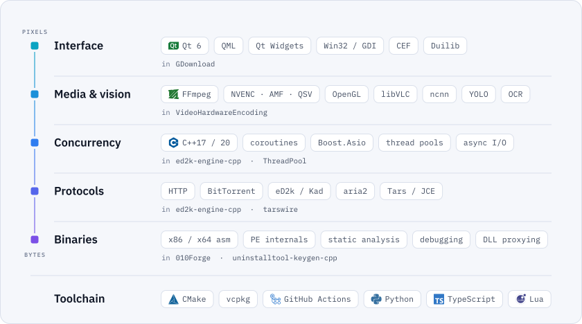</picture>

## Open source

<a href="https://github.com/cool2528/GDownload"><picture><source media="(prefers-color-scheme: dark)" srcset="https://raw.githubusercontent.com/cool2528/cool2528/output/gdownload-dark.svg">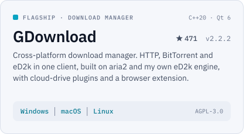</picture></a><a href="https://github.com/cool2528/GDownload"><picture><source media="(prefers-color-scheme: dark)" srcset="assets/gdownload-app-dark.png">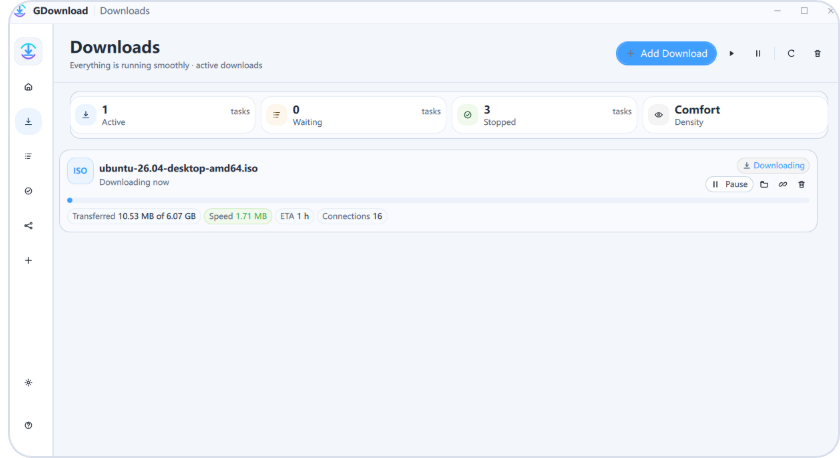</picture></a>
<a href="https://github.com/cool2528/ed2k-engine-cpp"><picture><source media="(prefers-color-scheme: dark)" srcset="https://raw.githubusercontent.com/cool2528/cool2528/output/ed2k-engine-cpp-dark.svg">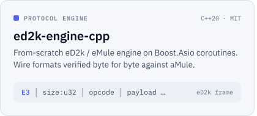</picture></a><a href="https://github.com/cool2528/tarswire"><picture><source media="(prefers-color-scheme: dark)" srcset="https://raw.githubusercontent.com/cool2528/cool2528/output/tarswire-dark.svg">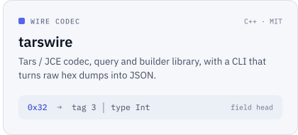</picture></a>
<a href="https://github.com/cool2528/VideoHardwareEncoding"><picture><source media="(prefers-color-scheme: dark)" srcset="https://raw.githubusercontent.com/cool2528/cool2528/output/VideoHardwareEncoding-dark.svg">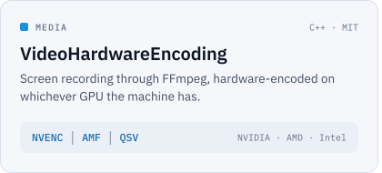</picture></a><a href="https://github.com/cool2528/linguist-ai"><picture><source media="(prefers-color-scheme: dark)" srcset="https://raw.githubusercontent.com/cool2528/cool2528/output/linguist-ai-dark.svg">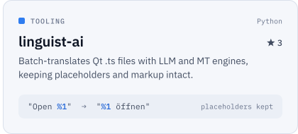</picture></a>

Also: [gd-browser-extension](https://github.com/cool2528/gd-browser-extension), which sends links from Chrome, Edge and Firefox to GDownload · [ThreadPool](https://github.com/cool2528/ThreadPool), a small C++17 thread pool with task priorities · [baiduCDP](https://github.com/cool2528/baiduCDP), an earlier Windows download client, now archived.

## Reverse engineering

I use static analysis and runtime observations to understand Windows programs. 010Forge traces how an application loads interface text. In uninstalltool-keygen-cpp, regression tests check my C++ model of the binary’s arithmetic.

<a href="https://github.com/cool2528/010Forge"><picture><source media="(prefers-color-scheme: dark)" srcset="https://raw.githubusercontent.com/cool2528/cool2528/output/010Forge-dark.svg">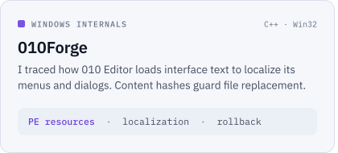</picture></a><a href="https://github.com/cool2528/uninstalltool-keygen-cpp"><picture><source media="(prefers-color-scheme: dark)" srcset="https://raw.githubusercontent.com/cool2528/cool2528/output/uninstalltool-keygen-cpp-dark.svg">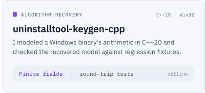</picture></a>

## GitHub

<picture><source media="(prefers-color-scheme: dark)" srcset="https://raw.githubusercontent.com/cool2528/cool2528/output/stats-dark.svg">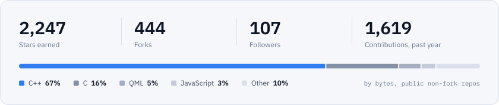</picture>

Contribution calendar

 

<picture><source media="(prefers-color-scheme: dark)" srcset="https://raw.githubusercontent.com/cool2528/cool2528/output/github-snake-dark.svg"></picture>

